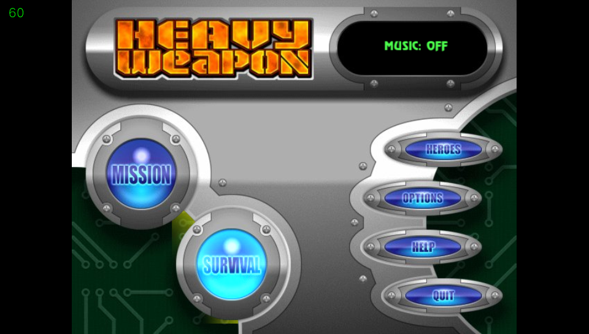
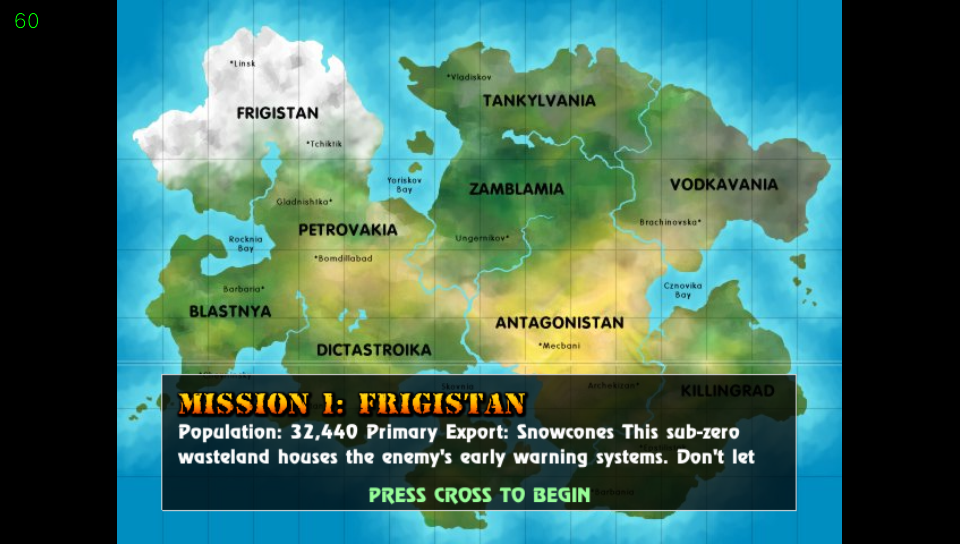
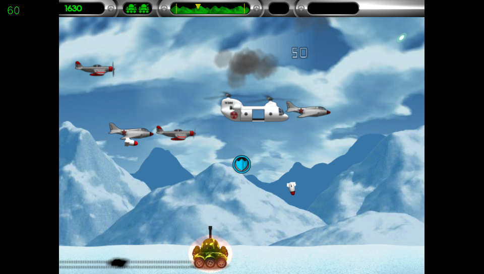
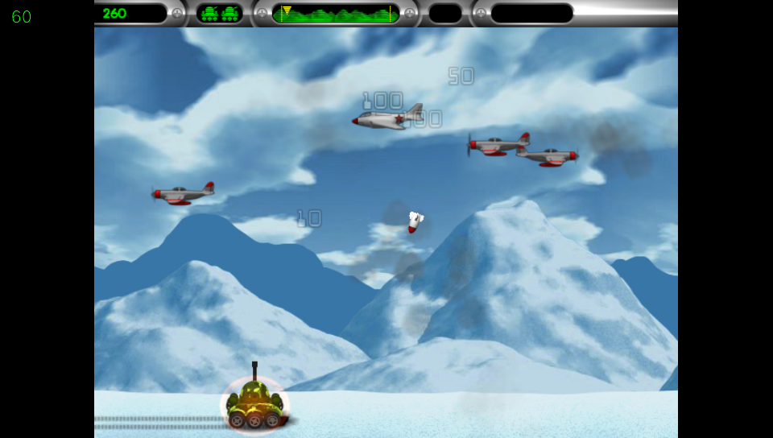

# Heavy Weapon

A native source port of PopCap's arcade tank shooter **Heavy Weapon Deluxe** for
**Windows x64** and **Linux x64**, written in C++17 on **SDL3** and OpenGL.

The game renders at its original 640×480 into an offscreen target, then scales that frame
to the window, either at 4:3 with black bars or stretched to fill.

| Title | Mission map |
| :---: | :---: |
|  |  |
|  |  |

> **No game assets are included.** You need your own copy of *Heavy Weapon Deluxe*
> (for example from Steam). The port reads the original game's data files.

---

## Features

- **Campaign:** all 19 missions with the original bosses, waves, enemy craft and the full
  Armory upgrade tree, loaded straight from the game's own XML (`levels.xml`, `waves.xml`,
  `craft.xml`, `bosses.xml`).
- **Survival mode:** endless waves from `survival0-9.xml` that step up every minute, with
  one tank, more frequent supply drops, and a saved best time.
- **Original look:** 4-plane parallax, PopCap's split `.jpg` + `_.png` alpha masks, additive
  effects and particles.
- **Controls:** drive with A/D and aim with the mouse, or play twin-stick on any gamepad,
  or use a touch screen.
- **Audio:** sound effects and menu music through SDL3_mixer, with a music toggle.
- **No load hitches:** every sprite and sound is preloaded at startup, behind a progress bar.

---

## Game data

Copy these folders from your *Heavy Weapon Deluxe* install, or point the game at the
install folder with `--data`:

```
data/      bosses.xml, craft.xml, credits.xml, levels.xml, waves.xml, survival0-9.xml
Fonts/
Images/
Music/     AtomicTank.mo3, LoveTheme.ogg
Sounds/
```

File names are matched case-insensitively, so the data works unchanged on Linux.

The game looks for data in this order and uses the first match:

1. `--data <dir>`
2. `Heavy Weapon Deluxe/`, then `./`, in the working directory
3. `Heavy Weapon Deluxe/`, then the executable's own folder
4. The folder baked in at configure time with `-DHW_DATA_DIR=<dir>`

`settings.ini` (music on/off, best survival time) is saved in the working directory.

---

## Windows x64

### Requirements

- **Visual Studio 2022** or the **Build Tools for Visual Studio 2022**, with the
  *Desktop development with C++* workload, which includes MSVC, CMake and Ninja.
- An internet connection on the first build. SDL3 3.4.20, SDL3_image 3.4.8 and
  SDL3_mixer 3.2.4 are downloaded from the official [libsdl-org](https://github.com/libsdl-org)
  release packages into the build folder.

### Build

```bat
tools\windows\build.cmd
```

This finds Visual Studio, sets up the x64 compiler, and builds `build-windows\heavyweapon.exe`.
It also copies the SDL3 DLLs next to the exe.

To build in a default data folder so the exe can be run from anywhere:

```bat
tools\windows\build.cmd "C:\Games\Heavy Weapon Deluxe"
```

To build by hand from an *x64 Native Tools Command Prompt*:

```bat
cmake --preset windows-x64
cmake --build --preset windows-x64
```

### Run

```bat
build-windows\heavyweapon.exe --data "C:\Games\Heavy Weapon Deluxe"
```

The exe is a windowed app. When it is started from a terminal, its log output goes to that
terminal. If it can't start, for example because no data was found, it shows an error box.
To ship a standalone copy, put `heavyweapon.exe` and every `.dll` from `build-windows\` in
one folder, with the game data folders next to them.

---

## Linux x64

### Requirements

A C++17 compiler, CMake 3.24 or newer, and OpenGL development files. For SDL3 you can use
either option:

- **Distribution packages**, if they're new enough (SDL3 ≥ 3.2, SDL3_image ≥ 3.2,
  SDL3_mixer ≥ 3.0). On Fedora 44:
  ```bash
  sudo dnf install gcc-c++ cmake SDL3-devel SDL3_image-devel SDL3_mixer-devel mesa-libGL-devel
  ```
- **Bundled.** If those packages are missing (for example on Ubuntu 24.04), CMake
  downloads the SDL3 release sources and builds them as static libraries. Force this with
  `-DHW_BUNDLE_SDL=ON`. SDL3 then needs its usual X11/Wayland/audio development packages.
  On Debian or Ubuntu:
  ```bash
  sudo apt install build-essential cmake ninja-build pkg-config libgl-dev libegl-dev \
      libx11-dev libxext-dev libxrandr-dev libxcursor-dev libxi-dev libxfixes-dev libxss-dev \
      libxtst-dev libwayland-dev wayland-protocols libxkbcommon-dev libdecor-0-dev \
      libpulse-dev libasound2-dev
  ```

### Build and run

```bash
cmake --preset linux-x64
cmake --build --preset linux-x64
./build-linux/heavyweapon --data "/path/to/Heavy Weapon Deluxe"
```

### Container helper

`tools/linux/hw.sh` builds and runs the game inside a Fedora container, so the host only
needs Podman or Docker. It expects the game data in `Heavy Weapon Deluxe/` at the repo root.

| Command | Does |
| :--- | :--- |
| `tools/linux/hw.sh image` | Builds the container image (once) |
| `tools/linux/hw.sh build` | Compiles into `build-linux/` |
| `tools/linux/hw.sh run` | Plays in a window, with sound |
| `tools/linux/hw.sh shot out.png --state play --level 2` | Renders a frame headlessly |

---

## Controls

| Action | Keyboard / mouse | Gamepad | Touch screen |
| :--- | :--- | :--- | :--- |
| Drive left / right | **A / D** (or ← / →) | Left stick, D-pad | Hold where the tank should go |
| Aim | Mouse | Right stick | Finger |
| Fire | Left click, Ctrl, J | A, RB, right stick pushed far | Finger down |
| Nuke | Right click, X, N | Y, LB | — |
| Pause | P, Esc | Start | — |
| Music on / off | Tab | Back | — |
| Menu confirm / back | Enter, Space / Esc, Backspace | A / B | Tap |

---

## Command-line options

| Option | Effect |
| :--- | :--- |
| `--data <dir>` | Game data directory, searched first |
| `--scale <n>` | Initial window size as a multiple of 640×480 (default 2) |
| `--stretch` | Fill the window instead of keeping 4:3 |
| `--state <title\|map\|play\|survival\|armory\|options\|help>` | Screen to start on |
| `--level <n>` | Mission index (0-based) for `map` / `play` |
| `--frames <n>` | Quit after *n* frames at a fixed 60 Hz |
| `--screenshot <file.png>` | Save the last 640×480 frame (with `--frames`) |
| `--autofire`, `--god`, `--armory <n>`, `--progress <n>` | Testing aids |

Example: `heavyweapon --state play --level 4 --frames 600 --screenshot level5.png`

---

## Project layout

```
src/core/       game loop, state machine, menus, optional profiler (HW_PERF)
src/game/       board, player tank, enemies, bosses, weapons, supplies, effects
src/render/     GL renderer, textures and alpha masks, bitmap fonts, parallax
src/platform/   case-insensitive file lookup, audio (SDL3_mixer), input
src/loader/     XML data loading
include/        headers
3rdparty/       tinyxml2
tools/windows/  Windows build script
tools/linux/    Linux container build / run / screenshot script
```

---

## Known limitations

- `AtomicTank.mo3` (the in-mission music) can't be decoded yet, so missions play
  without music. Sound effects and menu music work.
- Decorative background animations (igloos, snowmen, ...) are off by default. See
  `kDecorativeAnims` in `include/Constants.h`.

---

## Credits & legal

- Based on the PS Vita port by
  [Chillaxhson](https://github.com/Chillaxhson/heavy-weapon-deluxe-vita). This repository
  turned it into a Windows/Linux desktop port on SDL3.
- *Heavy Weapon Deluxe* is © 2005 PopCap Games, Inc. / Electronic Arts. This project is
  not affiliated with or endorsed by them.
- This repository contains no copyrighted game assets, music, or binaries. It is a fan
  project for preservation and personal use.
